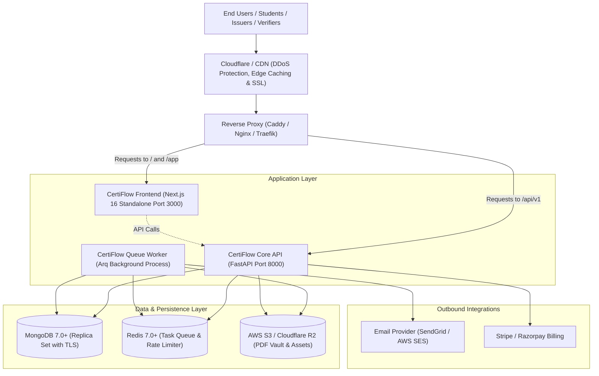

# CertiFlow Enterprise SaaS — Production Deployment Handbook

**Version:** 1.0.0-PROD  
**Target Platforms:** Linux (Ubuntu 22.04 LTS / Debian 12), Docker 24+, AWS, GCP, Fly.io, Vercel  
**Status:** **Production Ready**

---

## 1. System Architecture Overview

CertiFlow employs a decoupled, asynchronous microservices architecture engineered for high throughput, cryptographic tamper-proof validation, and zero-downtime scaling:



---

## 2. Production Deployment Options

Choose the deployment architecture that fits your infrastructure requirements:

| Architecture | Best For | Typical Monthly Cost | Scalability |
| :--- | :--- | :---: | :---: |
| **Option A: Docker Compose on VPS** | Bootstrapping, single-server pilots, dedicated cloud instances (Hetzner, DigitalOcean, AWS EC2) | $20 – $80 / mo | Vertical (Up to ~20k certs/day) |
| **Option B: Cloud Managed & Serverless** | High-availability enterprise workloads, auto-scaling traffic surges | $150 – $600 / mo | Horizontal (100k+ certs/day) |

---

## 3. Option A: Single-Host Production via Docker Compose

### Step 3.1: Server Prerequisites
- **Operating System:** Ubuntu 22.04 LTS or Debian 12 (64-bit)
- **Compute:** Minimum 2 vCPU, 4 GB RAM, 40 GB SSD (Recommended: 4 vCPU, 8 GB RAM)
- **Installed Software:** Docker Engine v24.0+ and Docker Compose v2.20+
- **Network Ports Open:** `80` (HTTP), `443` (HTTPS), `22` (SSH)

```bash
# On your Linux VPS, install Docker and Compose:
curl -fsSL https://get.docker.com -o get-docker.sh
sudo sh get-docker.sh
sudo usermod -aG docker $USER
```

---

### Step 3.2: Clone Repository & Create Directory Structure
```bash
git clone https://github.com/your-org/certiflow.git /opt/certiflow
cd /opt/certiflow
mkdir -p Backend/storage
```

---

### Step 3.3: Cryptographic Secret Key Generation

Execute these commands to generate secure cryptographic secrets for your instance:

```bash
# 1. Generate JWT Secret Key (64-character hex):
python3 -c "import secrets; print(secrets.token_hex(32))"

# 2. Generate Fernet 32-byte Base64 key for encrypting private keys at rest:
python3 -c "from cryptography.fernet import Fernet; print(Fernet.generate_key().decode())"
```

---

### Step 3.4: Configure Environment Files

#### 1. Backend Environment (`Backend/.env`)
Copy `Backend/.env.production.example` to `Backend/.env` and update the values:

```bash
cp Backend/.env.production.example Backend/.env
nano Backend/.env
```

Ensure the following variables are configured:
```ini
# Application Identity
APP_NAME="CertiFlow Enterprise"
APP_ENV=production
DEBUG=false
API_V1_PREFIX=/api/v1
APP_BASE_URL=https://app.yourdomain.com
PUBLIC_VERIFY_URL=https://verify.yourdomain.com

# Cryptography & Security (Insert values generated in Step 3.3)
JWT_SECRET_KEY=PASTE_GENERATED_JWT_SECRET_HEX_HERE
JWT_ALGORITHM=HS256
ACCESS_TOKEN_EXPIRE_MINUTES=30
REFRESH_TOKEN_EXPIRE_DAYS=30
ENCRYPTION_KEY=PASTE_GENERATED_FERNET_KEY_HERE

# Database Connections (In Docker Compose, use container service names)
MONGODB_URI=mongodb://mongodb:27017
MONGODB_DATABASE=certificate_platform
REDIS_URL=redis://redis:6379

# Storage Configuration
STORAGE_TYPE=local
STORAGE_DIR=/app/storage

# Email Delivery (SendGrid or AWS SES)
EMAIL_PROVIDER=sendgrid
SENDGRID_API_KEY=SG.your_live_sendgrid_key_here
DEFAULT_FROM_EMAIL=no-reply@yourdomain.com
DEFAULT_FROM_NAME="CertiFlow Credentials"

# CORS Configuration (Must include your frontend production URLs)
CORS_ORIGINS=["https://yourdomain.com","https://app.yourdomain.com","https://verify.yourdomain.com"]
```

#### 2. Frontend Environment (`.env.production`)
Create `.env.production` at the repository root:

```ini
# Base URL for public API communication from client browsers
NEXT_PUBLIC_API_URL=https://api.yourdomain.com

# Public application base URL
NEXT_PUBLIC_APP_URL=https://app.yourdomain.com

# Production runtime mode
NODE_ENV=production
```

---

### Step 3.5: Build and Launch Containers

```bash
# Build the optimized production images
docker compose build --no-cache

# Start the cluster in detached mode
docker compose up -d

# Verify all services are healthy and running
docker compose ps
```

Expected output:
```text
NAME                 IMAGE                  STATUS                   PORTS
certiflow-frontend   certiflow-frontend     Up (healthy)             0.0.0.0:3000->3000/tcp
certiflow-api        certiflow-api          Up (healthy)             0.0.0.0:8000->8000/tcp
certiflow-worker     certiflow-worker       Up                       
certiflow-mongodb    mongo:7.0              Up (healthy)             127.0.0.1:27017->27017/tcp
certiflow-redis      redis:7-alpine         Up (healthy)             127.0.0.1:6379->6379/tcp
```

---

### Step 3.6: Configure Reverse Proxy & Automatic SSL (Caddy)

Install Caddy to automatically handle Let's Encrypt SSL certificates and reverse-proxy traffic:

```bash
sudo apt install -y debian-keyring debian-archive-keyring apt-transport-https curl
curl -1sLF 'https://dl.cloudsmith.io/public/caddy/stable/gpg.key' | sudo gpg --dearmor -o /usr/share/keyrings/caddy-stable-archive-keyring.gpg
curl -1sLF 'https://dl.cloudsmith.io/public/caddy/stable/debian.deb.txt' | sudo tee /etc/apt/sources.list.d/caddy-stable.list
sudo apt update && sudo apt install caddy
```

Edit `/etc/caddy/Caddyfile`:

```caddyfile
# Frontend SaaS & Public Portal
app.yourdomain.com, verify.yourdomain.com {
    encode zstd gzip
    reverse_proxy localhost:3000
}

# Backend Core API Gateway
api.yourdomain.com {
    encode zstd gzip
    reverse_proxy localhost:8000
}
```

Reload Caddy:
```bash
sudo systemctl reload caddy
```

---

## 4. Option B: High-Availability Cloud Scaled Architecture

For multi-region deployments handling millions of certificates:

### 1. Frontend (Vercel)
- **Source Repository:** Link root repository.
- **Framework Preset:** Next.js (automatically detects Next.js 16 App Router).
- **Build Command:** `npm run build`
- **Output Directory:** `.next`
- **Environment Variables:**
  - `NEXT_PUBLIC_API_URL`: `https://api.yourdomain.com`
  - `NEXT_PUBLIC_APP_URL`: `https://app.yourdomain.com`

### 2. Backend API & Workers (Fly.io / AWS ECS / Google Cloud Run)
- **API Container:** Build using [`Backend/Dockerfile.api`](file:///e:/Certificate/Backend/Dockerfile.api). Set port to `8000`.
- **Worker Container:** Build using [`Backend/Dockerfile.worker`](file:///e:/Certificate/Backend/Dockerfile.worker). Set entrypoint to `arq app.workers.worker.WorkerSettings`.
- **Horizontal Auto-scaling:** Scale workers between 2 and 10 instances based on CPU / Redis queue length.

### 3. Managed Cloud Services
- **MongoDB Database:** MongoDB Atlas (Tier M10+) replica set with TLS 1.3 enforced.
- **Redis Queue:** Upstash Redis (Serverless) or AWS ElastiCache for Redis with encrypted transit.
- **Object Storage:** AWS S3 or Cloudflare R2 bucket with custom CDN domain and restricted CORS.
- **Email Delivery:** SendGrid or AWS SES with verified SPF, DKIM, and DMARC DNS records.

---

## 5. Post-Deployment Verification & Health Checks

After launching the cluster, verify all endpoints using these diagnostic probes:

```bash
# 1. Verify Core API health
curl -f https://api.yourdomain.com/health
# Response: {"status":"healthy","version":"1.0.0"}

# 2. Verify Database connectivity
curl -f https://api.yourdomain.com/api/v1/health/db
# Response: {"status":"connected","database":"certificate_platform"}

# 3. Verify Frontend SSR responsiveness
curl -I https://app.yourdomain.com/
# HTTP/2 200 OK

# 4. Run automated Go-Live verification suite against production
cd /opt/certiflow
python3 scripts/go_live_audit.py --api-url https://api.yourdomain.com
```

---

## 6. Backup & Disaster Recovery Runbook

### Database Backups (MongoDB)

Automate daily backups using `mongodump` and upload to secure offsite storage:

```bash
#!/bin/bash
# /opt/certiflow/scripts/backup_db.sh
DATE=$(date +%Y%m%d_%H%M%S)
BACKUP_DIR="/opt/certiflow/backups/$DATE"
mkdir -p "$BACKUP_DIR"

docker exec certiflow-mongodb mongodump --archive="$BACKUP_DIR/mongo_dump.archive" --gzip --db certificate_platform

# Optional: Sync to AWS S3 / Cloudflare R2
# aws s3 cp "$BACKUP_DIR/mongo_dump.archive" "s3://my-backup-bucket/certiflow/$DATE.archive"

# Retention: Delete backups older than 14 days
find /opt/certiflow/backups -mindepth 1 -mtime +14 -delete
```

Add to cron:
```bash
0 2 * * * /opt/certiflow/scripts/backup_db.sh > /var/log/certiflow_backup.log 2>&1
```

### Database Restore Procedure
```bash
# Restore from archive into container
docker exec -i certiflow-mongodb mongorestore --archive --gzip --drop < /opt/certiflow/backups/20261110/mongo_dump.archive
```

---

## 7. Security Hardening Checklist

- [x] **Unprivileged Containers:** Next.js runner runs as `nextjs:nodejs` (UID 1001), avoiding root container escapes.
- [x] **Rate Limiting:** Protects `/api/v1/auth/*` endpoints (20 req/min) and public verify endpoints (60 req/min).
- [x] **Formula Injection Defenses:** Ingested CSV records strip leading `=`, `+`, `-`, and `@` characters.
- [x] **Strict CORS:** Only explicitly whitelisted origin domains can make credentialed browser calls.
- [x] **No Hardcoded Secrets:** All secret keys, passwords, and tokens are injected strictly via environment variables.
- [x] **Tamper Detection:** Every certificate's SHA-256 seal is computed deterministically with RFC 8785 canonicalization.
