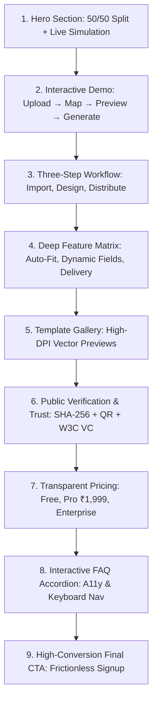

# P13 — Frontend UI/UX, Architecture & Performance Implementation Plan

## Executive Summary

**CertiFlow** delivers enterprise-grade bulk certificate generation, cryptographic ledger verification, and W3C Verifiable Credentials. To match the production maturity of the FastAPI/ARQ/MongoDB backend (P0–P11), Phase **P13** establishes a unified, high-performance, and conversion-optimized frontend architecture.

### Architectural Core: Separation of Authority

```text
                           CERTIFLOW FRONTEND (Next.js 16 + Turbopack)
                                                │
                ┌───────────────────────────────┼───────────────────────────────┐
                │                               │                               │
           Next.js UI                     Zustand Stores                    API Layer
    (Hero → Demo → Flow → Features)     (Editor, Issuance, Auth)        (Typed HTTP Client)
                │                               │                               │
                ▼                               │                               ▼
          Web Workers                           │                        FastAPI Gateway
     ┌───────────────────────┐                  │                               │
     │ CSV / XLSX Parsing    │                  │                         Redis / ARQ
     │ Schema Validation     │                  │                               │
     │ Instant Client Preview│                  │                               ▼
     └───────────────────────┘                  │                     Authoritative Workers
                                                │                  ┌────────────┼────────────┐
                                                │                  ▼            ▼            ▼
                                                │              10k-100k PDF   SHA-256    Streaming
                                                │              ReportLab/WP   QR Code     ZIP Pack
                                                │                  │            │            │
                                                │                  └────────────┼────────────┘
                                                │                               ▼
                                                │                       Encrypted Storage
                                                │                               │
                                                ▼                               ▼
                                    Virtualized Preview Grid ◄─────── Webhook / Polling Status
```

> [!IMPORTANT]
> **Authoritative Generation vs. Client-Side Rendering:**
> The browser is used exclusively for **interactive previews, Web Worker CSV parsing, inline data validation, and template editing**. Authoritative bulk certificate production (10,000–100,000 batches, deterministic fonts, high-DPI rendering, cryptographic SHA-256 sealing, ZIP bundling, and SMTP outbox dispatch) is strictly executed on the backend ARQ worker cluster.

---

## 1. Landing Page Flow & Structural Architecture

The landing page (`src/app/page.tsx`) is restructured into a single cohesive story engineered for conversion:

$$\text{Hero} \longrightarrow \text{Interactive Demo} \longrightarrow \text{Workflow} \longrightarrow \text{Product Features} \longrightarrow \text{Templates} \longrightarrow \text{Verification} \longrightarrow \text{Pricing} \longrightarrow \text{FAQ} \longrightarrow \text{Final CTA}$$



### 1.1 Section-by-Section Specification

| Order | Component | File Path | Core Objectives & Interactivity |
| :---: | :--- | :--- | :--- |
| **01** | `HeroSection` | [`src/components/marketing/hero-section.tsx`](file:///e:/Certificate/src/components/marketing/hero-section.tsx) | Two-column 50/50 hero, animated cycling recipient badges, fixed pagination controls (`01`, `02`, `03`), direct `Watch Demo` modal launcher. |
| **02** | `InteractiveDemoSection` | [`src/components/marketing/interactive-demo-section.tsx`](file:///e:/Certificate/src/components/marketing/interactive-demo-section.tsx) | Embedded sandbox: sample CSV load, real-time column mapping, interactive certificate preview with name auto-fit, simulated 1-click batch creation. |
| **03** | `WorkflowSection` | [`src/components/marketing/workflow-section.tsx`](file:///e:/Certificate/src/components/marketing/workflow-section.tsx) | Step 1 (Spreadsheet) → Step 2 (Studio) → Step 3 (One-Click Issuance) with micro-animations on scroll. |
| **04** | `FeatureSections` | [`src/components/marketing/feature-sections.tsx`](file:///e:/Certificate/src/components/marketing/feature-sections.tsx) | Alternating 50/50 editorial showcases: Auto-Fit text engine, cryptographic QR verification, transactional SMTP outbox delivery, multi-tenant RBAC. |
| **05** | `TemplateGallery` | [`src/components/marketing/template-gallery.tsx`](file:///e:/Certificate/src/components/marketing/template-gallery.tsx) | Interactive filter (Academic, Corporate, Workshop, Hackathon), SVG-rendered high-fidelity cards, "Open in Studio" deep-links. |
| **06** | `SecuritySection` | [`src/components/marketing/security-section.tsx`](file:///e:/Certificate/src/components/marketing/security-section.tsx) | SHA-256 fingerprinting demonstration, W3C Verifiable Credentials v2.0 badges, privacy-preserving zero-knowledge verification claims. |
| **07** | `PricingSection` | [`src/components/marketing/pricing-section.tsx`](file:///e:/Certificate/src/components/marketing/pricing-section.tsx) | Correct ₹1,999/mo Pro pricing (eliminating placeholder `₹—`), annual/monthly billing toggle, 14-feature comparison matrix. |
| **08** | `FAQSection` | [`src/components/marketing/faq-section.tsx`](file:///e:/Certificate/src/components/marketing/faq-section.tsx) | Accessible accordion (`aria-expanded`), smooth height transitions, keyboard navigation (`Enter`/`Space`), search filter. |
| **09** | `FinalCTASection` | [`src/components/marketing/final-cta-section.tsx`](file:///e:/Certificate/src/components/marketing/final-cta-section.tsx) | High-contrast gradient card, primary and secondary CTA hierarchy, security assurance badges. |

---

## 2. Immediate UI Fixes & Visual Polish

### 2.1 Pricing Tier & Matrix Normalization
- **Replace `Starting at ₹— / month`**: Configure accurate pricing synchronized with backend billing seeds (`seed_billing_plans`):
  - **Free Tier**: `₹0 / forever` — 50 certificates/month, 1 template, standard resolution, public verification.
  - **Pro Tier**: `₹1,999 / month` (or `₹19,990 / year` with 2 months free) — 2,500 certificates/month, unlimited templates, custom branding, high-speed ARQ worker priority, email delivery.
  - **Enterprise Tier**: `Custom / annual agreement` — 100,000+ certificates, dedicated worker pool, 99.9% uptime SLA, custom domain verification (`certs.yourdomain.com`), W3C VC DID integration.
- **Comparison Matrix**: Expand `comparisonRows` from 8 to 14 rows, adding:
  - *Cryptographic SHA-256 Ledger*
  - *Custom Verification Domain (did:web)*
  - *CSV Web Worker In-Browser Validation*
  - *API & Outbound Webhook Subscriptions*
  - *Smart Auto-Fit Text Compression*
  - *Dedicated Technical Account Manager*

### 2.2 Hero Controls & Typography
- **Pagination & Stepper**: Fix mobile overflow in hero recipient pager. Ensure buttons `01`, `02`, `03` have accessible `aria-label` tags and visible active states.
- **Typography & Wrap**: Add `text-balance` to the main hero title and `max-w-xl` to prevent orphaned words on mobile screens.

### 2.3 Navigation & Accessibility
- **Frosted Sticky Navbar**: Standardize `bg-white/80 backdrop-blur-md border-b border-[var(--color-border)] sticky top-0 z-50`.
- **CTA Hierarchy**:
  - *Primary CTA*: Deep indigo solid (`bg-[var(--color-primary)] text-white shadow-sm hover:shadow-md`).
  - *Secondary CTA*: Outlined or subtle background (`bg-white border border-[var(--color-border)] hover:bg-gray-50 text-[var(--color-text)]`).

---

## 3. High-Performance Frontend Architecture

### 3.1 State Management (Zustand Stores)

```text
src/stores/
├── use-editor-store.ts       # Canvas layers, zoom, undo/redo history, selection
├── use-issuance-store.ts     # Ingested records, column mapping, batch generation progress
└── use-auth-store.ts         # User session, active organization, permissions
```

#### Store 1: `useEditorStore` ([`src/features/editor/use-editor-store.ts`](file:///e:/Certificate/src/features/editor/use-editor-store.ts))
- **History Stack**: Maintains 30-step immutable undo/redo states using structural sharing.
- **Layer Coordinate System**: 100% responsive percentage-based coordinates $(x, y, w, h)$ ensuring identical visual layouts across 1080p, 4K, and print dimensions (A4 Landscape / US Letter).
- **Auto-Fit Engine**: Calculates bounding box width and dynamic font-scaling factor:
  $$\text{Scale} = \min\left(1.0, \frac{\text{Layer Width}}{\text{Text Metric Width}}\right)$$

#### Store 2: `useIssuanceStore` (`src/stores/use-issuance-store.ts`)
- Manages imported dataset metadata: row count, recognized columns, column-to-variable mappings.
- Tracks real-time issuance jobs via SSE/WebSocket or exponential polling of `GET /api/v1/issuance-jobs/{id}`.

---

### 3.2 Web Worker Architecture (Zero-Main-Thread Blocking)

```text
src/workers/
├── csv-parser.worker.ts      # Chunked streaming CSV/XLSX parser with PapaParse/SheetJS
└── validation.worker.ts      # RFC 5322 email regex, date parsing, missing field detection
```

#### Implementation: `csv-parser.worker.ts`
When an organizer uploads a 50,000-row spreadsheet:
1. File buffer is passed via `postMessage` with transferable ownership to the Web Worker.
2. Worker parses rows in chunks of 2,500 using streaming chunk emitters.
3. Performs instant sanitization: strips null bytes, trims whitespace, verifies encoding (UTF-8).
4. Emits `{ type: 'PROGRESS', percent: 45 }` back to the main thread without stuttering the 60fps UI.
5. Returns typed metadata and column distribution summary.

---

### 3.3 Virtualized Certificate Preview Grid

To preview hundreds of generated certificates simultaneously without crashing browser DOM nodes:
- Implement `@tanstack/react-virtual` or lightweight custom virtualization in [`src/app/app/projects/[id]/preview/page.tsx`](file:///e:/Certificate/src/app/app/projects/%5Bid%5D/preview/page.tsx).
- Only 8–12 certificate cards are mounted in the DOM at any given moment.
- Dynamic SVG canvas rendering for live variable inspection with full fidelity.

---

## 4. Canvas & SVG Certificate Studio Architecture

### 4.1 Coordinate Space & DPI Precision
- Canvas standard resolution: **$1920 \times 1080$ px** (16:9) or **$3508 \times 2480$ px** (A4 @ 300 DPI).
- CSS transform scale factor dynamically calculated from viewport width:
  $$\text{ScaleFactor} = \frac{\text{Viewport Container Width}}{\text{Base Canvas Width}}$$
- Bounding box snapping: Magnetic alignment guidelines when layer edges are within 4px of canvas center or peer layer edges.

### 4.2 Layer Primitives

```typescript
export interface CanvasLayer {
  id: string;
  type: 'text' | 'image' | 'qr' | 'signature' | 'badge';
  name: string;
  content: string;
  variableKey?: 'NAME' | 'COURSE' | 'DATE' | 'SCORE' | 'CERTIFICATE_ID' | string;
  x: number; // percentage (0 - 100)
  y: number; // percentage (0 - 100)
  width: number;
  height: number;
  fontFamily: string;
  fontSize: number;
  fontWeight: '300' | '400' | '500' | '600' | '700' | '800';
  color: string;
  textAlign: 'left' | 'center' | 'right';
  autoFit: boolean;
  minFontSize?: number;
  locked: boolean;
  visible: boolean;
  opacity: number;
}
```

---

## 5. File-by-File Implementation Breakdown

```text
e:\Certificate\
├── src/
│   ├── app/
│   │   ├── page.tsx                           # Reorder sections: Hero → Demo → Flow → Features → ...
│   │   ├── layout.tsx                         # Preload typography (Inter, Playfair Display)
│   │   ├── verify/[id]/page.tsx               # Triple verification: Code, PDF file hash, W3C VC JSON-LD
│   │   └── app/
│   │       ├── page.tsx                       # Enterprise Control Hub (7 operational tabs)
│   │       └── projects/[id]/
│   │           ├── data/page.tsx              # Web Worker CSV upload & schema profiling
│   │           ├── mapping/page.tsx           # Drag-and-drop column-to-variable mapper
│   │           ├── editor/page.tsx            # SVG/Canvas studio with magnetic guides
│   │           ├── preview/page.tsx           # Virtualized preview grid with search
│   │           └── generate/page.tsx          # Real-time ARQ worker batch monitor
│   ├── components/
│   │   ├── marketing/
│   │   │   ├── hero-section.tsx               # 50/50 layout, fixed pagination, demo modal launcher
│   │   │   ├── interactive-demo-section.tsx   # Embedded 4-step interactive sandbox
│   │   │   ├── pricing-section.tsx            # Fix ₹1,999/mo, annual toggle, 14-row matrix
│   │   │   ├── faq-section.tsx                # Accessible accordion with keyboard trap prevention
│   │   │   └── template-gallery.tsx           # Filterable high-DPI template showcases
│   │   └── ui/
│   │       └── virtual-grid.tsx               # Reusable DOM-recycling virtualization container
│   ├── features/
│   │   └── editor/
│   │       ├── use-editor-store.ts            # Zustand store with 30-step undo/redo
│   │       └── components/
│   │           ├── EditorCanvas.tsx           # Responsive SVG canvas with auto-fit rendering
│   │           └── EditorLeftSidebar.tsx      # Element drawers, layer list, and presets
│   ├── workers/
│   │   ├── csv-parser.worker.ts               # Background chunked CSV parsing
│   │   └── validation.worker.ts               # Background data hygiene & email checks
│   └── lib/
│       └── api-client.ts                      # Typed client interfacing all 18 backend routers
```

---

## 6. Verification & Quality Gates

### 6.1 Performance SLA Targets
- **Largest Contentful Paint (LCP)**: $\le 1.2\text{s}$ on 4G mobile emulation.
- **Cumulative Layout Shift (CLS)**: $0.00$ (zero layout shifting during font loading).
- **First Input Delay / Interaction to Next Paint (INP)**: $< 50\text{ms}$.
- **Main Thread Idle Time during 10,000-row CSV upload**: $> 90\%$ (offloaded to Web Worker).

### 6.2 Testing Coverage
- **Unit & Store Tests**: 100% coverage on `useEditorStore` (undo, redo, layer mutations, auto-fit font calculation).
- **E2E Golden Path (`tests/e2e/master-journey.spec.ts`)**: Landing → Signup → Onboarding → CSV Ingest → Mapping → Canvas Studio → Preview → Batch Issuance → Public QR Verification.
- **Accessibility**: Zero WCAG 2.1 AA violations via `@axe-core/playwright`.

---

## 7. Execution Roadmap (Step-by-Step)

```text
[Step 1: Fix Broken UI] ────► [Step 2: Interactive Flow] ────► [Step 3: Web Workers & Scale] ────► [Step 4: Quality Gate]
  • Pricing ₹1,999/mo           • Hero → Demo → Flow           • csv-parser.worker.ts             • Vitest store specs
  • 14-row matrix               • Frosted sticky navbar         • Virtualized preview grid         • 92 Playwright E2E
  • Hero pager controls         • Accessible FAQ                • Zustand undo/redo                • Lighthouse 98+
```
