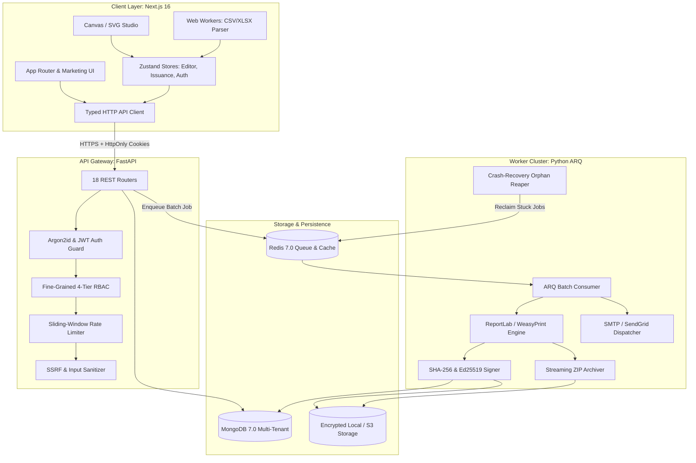

# CertiFlow — System Architecture & Design Specification

## 1. Architectural Philosophy & Core Tenet

CertiFlow implements a strict **separation of authority**:

```text
                           CERTIFLOW CLIENT (Next.js 16 + Turbopack)
                                                │
                ┌───────────────────────────────┼───────────────────────────────┐
                │                               │                               │
           Next.js UI                     Zustand Stores                    API Layer
    (Hero → Demo → Flow → Features)     (Editor, Issuance, Auth)        (Typed HTTP Client)
                │                               │                               │
                ▼                               │                               ▼
          Web Workers                           │                        FastAPI Gateway
     ┌───────────────────────┐                  │                               │
     │ CSV / XLSX Parsing    │                  │                         Redis / ARQ
     │ Schema Validation     │                  │                               │
     │ Instant Client Preview│                  │                               ▼
     └───────────────────────┘                  │                     Authoritative Workers
                                                │                  ┌────────────┼────────────┐
                                                │                  ▼            ▼            ▼
                                                │              10k-100k PDF   SHA-256    Streaming
                                                │              ReportLab/WP   QR Code     ZIP Pack
                                                │                  │            │            │
                                                │                  └────────────┼────────────┘
                                                │                               ▼
                                                │                       Encrypted Storage
                                                │                               │
                                                ▼                               ▼
                                    Virtualized Preview Grid ◄─────── Webhook / Polling Status
```

### Why This Separation Matters
1. **Determinism**: Client-side canvas/HTML-to-PDF rendering varies across browser engines, operating systems, and installed fonts. Authoritative batch PDF generation on Linux containers with ReportLab and WeasyPrint produces bit-for-bit identical vector output.
2. **Scale**: Generating 50,000 PDF certificates in a browser tab leads to memory exhaustion and browser tab crashes. The background ARQ worker cluster partitions jobs into concurrent batches with automatic crash recovery.
3. **Cryptographic Integrity**: The private Ed25519 signing keys and SHA-256 signature ledgers must never touch client code. Signing happens within secure worker processes.
4. **Lightweight Client UX**: The browser handles non-blocking CSV parsing, real-time font auto-fitting, instant interactive previewing, and drag-and-drop template composition at 60 FPS.

---

## 2. High-Level Component Topology



---

## 3. Data Flow Pipelines

### 3.1 Template Creation & Canvas Serialization
1. The user designs a certificate in `/app/projects/[id]/editor` using `EditorCanvas.tsx`.
2. Coordinates $(x, y, w, h)$ are normalized as percentages ($0.00\% - 100.00\%$) relative to the base canvas dimension ($1920 \times 1080$ px).
3. Dynamic placeholders (e.g. `{{NAME}}`, `{{COURSE}}`, `{{DATE}}`) are bound to layers.
4. On save, the layout is committed via `POST /api/v1/templates/{id}/versions` with an immutable version ID.

### 3.2 Dataset Ingestion & Schema Profiling
1. User drops a CSV or XLSX spreadsheet in `/app/projects/[id]/data`.
2. The Web Worker parses rows in chunks of 2,500 without locking the main thread.
3. Headers are matched to template variables using a 5-tier matching engine:
   - Tier 1: Exact string match (`"Full Name"` $\to$ `"Full Name"`).
   - Tier 2: Normalized slug (`"student-name"` $\to$ `"student_name"`).
   - Tier 3: Synonym dictionary (`"Learner"`, `"Attendee"` $\to$ `"recipient_name"`).
   - Tier 4: Value regex heuristics (matches email values to `{{EMAIL}}`).
   - Tier 5: Levenshtein distance scoring ($> 0.8$ threshold).

### 3.3 Authoritative Batch Compilation
1. User confirms mapping and initiates batch issuance in `/app/projects/[id]/generate`.
2. Frontend dispatches `POST /api/v1/issuance-jobs` with `template_version_id`, dataset records, and idempotency key.
3. Backend atomically sets job status to `PENDING` and enqueues tasks into Redis.
4. ARQ worker claims batch atomically (`claim_batch`):
   - Compiles vector PDF via ReportLab / WeasyPrint.
   - Calculates dynamic font scaling for long recipient names.
   - Generates unique QR verification code pointing to `/verify/{code}`.
   - Computes SHA-256 cryptographic checksum of generated PDF bytes.
   - Signs W3C Verifiable Credential using organization's Ed25519 private key.
   - Writes immutable issuance ledger record to MongoDB `certificates` collection.
   - Appends PDF bytes to streaming ZIP archive.
5. Emits real-time progress events to client via WebSocket / polling.

---

## 4. Finite State Machines

### 4.1 Certificate Lifecycle State Machine

```text
                           ┌──────────────┐
                           │   PENDING    │
                           └──────┬───────┘
                                  │ (Worker Claims Item)
                                  ▼
                           ┌──────────────┐
                     ┌────►│  PROCESSING  │◄────┐
                     │     └──────┬───────┘     │
        (Retry Item) │            │             │ (Reaper Reclaims Orphan)
                     │    ┌───────┴───────┐     │
                     │    │               │     │
                 success  │               │ failure (attempts < 3)
                     │    ▼               ▼     │
               ┌───────────┐         ┌──────────┴┐
               │  ISSUED   │         │  FAILED   │
               │(generated)│         └─────┬─────┘
               └─────┬─────┘               │ failure (attempts >= 3)
                     │                     ▼
              revoke │              [WORKER_TIMEOUT]
                     ▼
               ┌───────────┐
               │  REVOKED  │
               └─────┬─────┘
                     │ restore
                     ▼
               ┌───────────┐
               │  ISSUED   │
               └───────────┘
```

### 4.2 Issuance Job State Machine

```text
  [QUEUED] ──► [CLAIMED] ──► [PROCESSING (0-100%)] ──► [COMPLETED]
                   │                   │
                   ▼ (Worker Crash)     ▼ (Fatal Render Error)
              [RECLAIMED]          [FAILED / PARTIAL]
```

---

## 5. Security & Threat Modeling

| Threat Category | Potential Attack Vector | CertiFlow Mitigation Architecture |
| :--- | :--- | :--- |
| **Authentication** | Credential stuffing, brute force, token hijacking | Argon2id hashing, 15m access / 7d refresh token rotation, HttpOnly SameSite=Lax cookies, sliding-window IP rate limiting. |
| **Authorization** | BOLA / IDOR cross-tenant access | Every database query scopes to authenticated `organization_id`. 4-tier RBAC (Owner, Admin, Member, Viewer). |
| **Tampering** | Photoshopped PDF certificates | Immutable SHA-256 PDF byte checksums registered in MongoDB. Public portal computes file hash in-browser and matches ledger. |
| **SSRF** | Template logo / image remote URL fetching | Strict private IP blocking (rejects RFC 1918, loopback 127.0.0.1, AWS metadata 169.254.169.254). Magic byte image validation. |
| **XSS / Injection** | Malicious script payloads in recipient names | Contextual HTML escaping in templates, React JSX DOM auto-escaping, Content-Security-Policy headers. |
| **Key Leakage** | Exposure of Ed25519 private keys | Asymmetric private keys encrypted at rest using Fernet with master key from environment variables. Never returned in API responses. |
| **Enumeration** | User / certificate existence discovery | Constant-time responses for forgot-password; rate-limited randomized certificate IDs (`CERT-XXXXXX`). |

---

## 6. Directory Layout Standards

```text
e:\Certificate\
├── Backend/                     # FastAPI ASGI Microservice
│   ├── app/
│   │   ├── api/v1/              # 18 REST Routers
│   │   ├── core/                # Config, Security, Database, Middleware
│   │   ├── models/              # MongoDB BSON Document Models
│   │   ├── schemas/             # Pydantic v2 Contract Envelopes
│   │   ├── services/            # Domain Business Logic
│   │   ├── queue/               # ARQ Background Task Definitions
│   │   └── render/              # PDF Vector Compiler & Cryptography
│   └── tests/                   # 247 Automated Pytest Suites
├── src/                         # Next.js 16 Web Application
│   ├── app/                     # App Router Routes & Nested Layouts
│   ├── components/              # UI Atoms & Marketing Editorial Sections
│   ├── features/                # Editor Studio, Auth Guards, Organization State
│   ├── lib/api/                 # Modular Typed API Client (18 Domains)
│   ├── workers/                 # Web Worker Background Parsers
│   └── types/                   # TypeScript Interfaces & Pydantic Mirrors
└── tests/e2e/                   # 114 Automated Playwright E2E Suites
```
