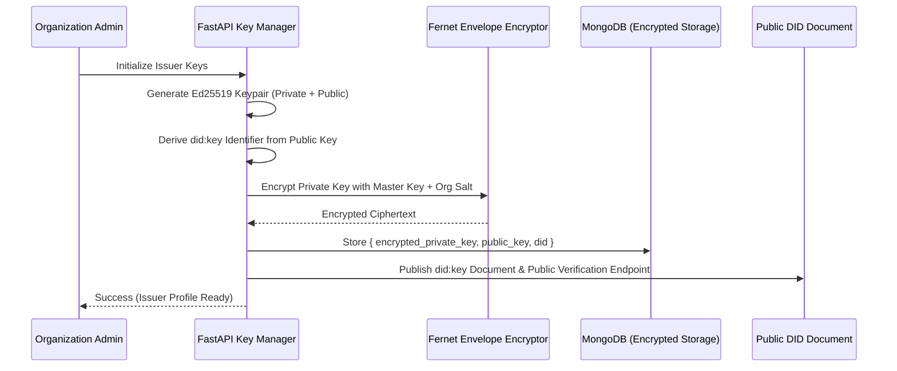
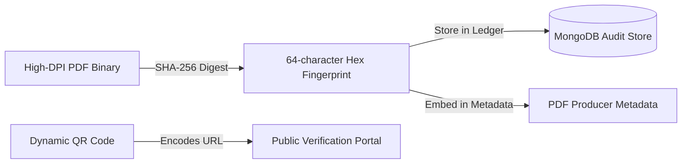

# CertiFlow — Standards Compliance & Cryptographic Proof Specification

This document details CertiFlow's compliance with international digital credential standards, specifically the **W3C Verifiable Credentials Data Model v2.0** and the **1EdTech Open Badges 3.0 Specification**, along with our underlying cryptographic signing, key management, and tamper-proofing architectures.

---

## 1. Overview of Standards

Digital credentials issued by CertiFlow serve two complementary purposes:
1. **Human-Readable Presentation**: High-resolution (300 DPI) PDF certificates designed for printing, framing, and visual presentation.
2. **Machine-Readable Cryptographic Proof**: Interoperable JSON-LD credentials signed with asymmetric keys that can be verified mathematically and imported into universal digital wallets (Apple Wallet, Google Wallet, Learner Wallets).

```text
┌────────────────────────────────────────────────────────────────────────┐
│                        CertiFlow Dual Credential                       │
├──────────────────────────────────┬─────────────────────────────────────┤
│       Visual Certificate         │        Portable Digital Badge       │
├──────────────────────────────────┼─────────────────────────────────────┤
│ • 300 DPI Vector PDF / SVG       │ • W3C Verifiable Credential v2.0    │
│ • Precision Typography & Layout  │ • 1EdTech Open Badges 3.0           │
│ • Scannable Dynamic QR Code      │ • Ed25519 Asymmetric Signature     │
│ • Tamper-evident SHA-256 Seal    │ • RFC 8785 JSON Canonicalization    │
│ • High-resolution Brand Logos    │ • Decentralized Identifiers (DIDs)  │
└──────────────────────────────────┴─────────────────────────────────────┘
```

---

## 2. W3C Verifiable Credentials Data Model v2.0 Compliance

CertiFlow implements the [W3C Verifiable Credentials Data Model v2.0 Candidate Recommendation](https://www.w3.org/TR/vc-data-model-2.0/).

### 2.1 JSON-LD Contexts & Structural Schema

Every issued verifiable credential conforms strictly to the schema below:

```json
{
  "@context": [
    "https://www.w3.org/ns/credentials/v2",
    "https://purl.imsglobal.org/spec/ob/v3p0/context-3.0.3.json",
    "https://w3id.org/security/suites/ed25519-2020/v1"
  ],
  "id": "urn:uuid:f81d4fae-7dec-11d0-a765-00a0c91e6bf6",
  "type": [
    "VerifiableCredential",
    "OpenBadgeCredential"
  ],
  "issuer": {
    "id": "did:key:z6MkpTHR8VNsBxYAAWHut2Geadd9jSwuBV8xRoAnwWsdvktH",
    "type": ["Profile"],
    "name": "Acme Institute of Technology",
    "url": "https://acme.edu",
    "email": "credentials@acme.edu"
  },
  "validFrom": "2026-10-02T12:00:00Z",
  "name": "Certified Cloud Solutions Architect",
  "description": "Awarded for demonstrating mastery in scalable cloud infrastructure.",
  "credentialSubject": {
    "id": "did:mailto:alice.johnson@example.com",
    "type": ["AchievementSubject"],
    "name": "Alice Johnson",
    "achievement": {
      "id": "urn:uuid:6c84fb90-12c4-11e1-840d-7b25c5ee775a",
      "type": ["Achievement"],
      "name": "Certified Cloud Solutions Architect",
      "description": "Demonstrated mastery of distributed systems, serverless architecture, and security hardening.",
      "criteria": {
        "narrative": "Completed 120 hours of hands-on architectural labs and achieved >90% score on the capstone examination."
      },
      "image": {
        "id": "https://cdn.certiflow.io/badges/cloud-architect.png",
        "type": "Image"
      }
    }
  },
  "credentialStatus": {
    "id": "https://api.certiflow.io/api/v1/public/status/status-list-2026#412",
    "type": "BitstringStatusListEntry",
    "statusPurpose": "revocation",
    "statusListIndex": "412",
    "statusListCredential": "https://api.certiflow.io/api/v1/public/status/status-list-2026"
  },
  "proof": {
    "type": "Ed25519Signature2020",
    "created": "2026-10-02T12:00:05Z",
    "verificationMethod": "did:key:z6MkpTHR8VNsBxYAAWHut2Geadd9jSwuBV8xRoAnwWsdvktH#z6MkpTHR8VNsBxYAAWHut2Geadd9jSwuBV8xRoAnwWsdvktH",
    "proofPurpose": "assertionMethod",
    "proofValue": "z24fJ8B9a1..."
  }
}
```

### 2.2 Key Elements of Compliance

1. **`@context`**: Explicit inclusion of the official W3C Credentials v2 vocabulary, 1EdTech Open Badges v3.0 schema, and Ed25519-2020 crypto-suite definition.
2. **`id`**: Unique URN/URI identifier ensuring universal referenceability.
3. **`issuer`**: Uses Decentralized Identifiers (`did:key` or `did:web`) resolving directly to the issuing organization's public cryptographic verification key.
4. **`credentialSubject`**: Fully decoupled from the visual PDF layout, storing the recipient's identity, achievement attributes, and criteria.
5. **`credentialStatus`**: Compliant with the W3C Bitstring Status List v1.0 standard, allowing verifiers to perform instant, lightweight bit-vector revocation checks without revealing the recipient's identity.

---

## 3. 1EdTech Open Badges 3.0 (OBv3) Specification

Open Badges 3.0 standardizes digital skill assertions directly on top of the W3C Verifiable Credentials Data Model, replacing legacy un-signed JSON metadata with cryptographically verifiable assertions.

### 3.1 Data Model Alignment

CertiFlow implements the three core OBv3 entities:

| Entity | OBv3 Representation | Purpose in CertiFlow |
| :--- | :--- | :--- |
| **Issuer Profile** | `Profile` object with DID | Represents the organization, university, or enterprise issuing the badge. |
| **Achievement** | `Achievement` object inside `credentialSubject` | Details the skill, certification, course, or award earned, including criteria and rubric. |
| **Assertion** | The root `VerifiableCredential` document | Binds the recipient to the achievement with an immutable cryptographic proof. |

### 3.2 Backward Compatibility & Export Formats

CertiFlow guarantees interoperability across badge ecosystems:
- **OBv3 JSON-LD**: Downloadable native JSON-LD for importing into modern W3C/OBv3 learner wallets.
- **OBv2 Hosted Verification**: A fallback endpoint compatible with legacy Open Badges 2.0 backpack services.
- **1-Click LinkedIn Certification**: Direct URL generator that populates the official LinkedIn "Add Certification" flow with organization name, issue date, credential ID, and verification link.

---

## 4. Cryptographic Proof Engine

CertiFlow's cryptographic architecture is built to guarantee authenticity, non-repudiation, and tamper detection without requiring verifiers to trust CertiFlow's internal database.

### 4.1 Cryptographic Algorithms

- **Signature Scheme**: `Ed25519` (Edwards-curve Digital Signature Algorithm over Curve25519) adhering to RFC 8032.
  - Key size: 256 bits (provides 128-bit security level, equivalent to 3072-bit RSA).
  - Fast signature verification (<0.5ms) suitable for high-frequency automated verification.
  - Immune to side-channel timing attacks and implementation-dependent random number failures.
- **Hashing**: `SHA-256` (FIPS 180-4) for message digesting and PDF binary integrity seals.
- **Key Derivation & Protection**: `Argon2id` for password hashing; `Fernet` (AES-128-CBC + HMAC-SHA256 authenticated encryption) for issuer private keys at rest.

---

### 4.2 Key Generation & Storage Lifecycle

Each organization in CertiFlow has its own dedicated Ed25519 keypair:



1. **Private Key Protection**: Private keys are never stored in plaintext. They are encrypted using an envelope encryption pattern via `Fernet` using a master secret derived from `FERNET_MASTER_KEY` and the organization's unique salt.
2. **Decentralized Identifier (`did:key`)**: The public key is encoded into a standard `did:key` representation (using multicodec `0xed` and multibase `z` encoding). Verifiers can extract the public key directly from the DID without making network requests.

---

### 4.3 Deterministic JSON Canonicalization (RFC 8785)

Before calculating an Ed25519 cryptographic signature, the JSON-LD document must be converted into a deterministic sequence of bytes. Different JSON serializers produce varying whitespace, floating-point formats, and dictionary key orderings, which would cause signature verification to fail.

CertiFlow implements the official **RFC 8785 JSON Canonicalization Scheme (JCS)**:

```python
# app/credentials/canonicalizer.py
def canonicalize_json(data: dict) -> bytes:
    """
    Produces RFC 8785 canonical JSON bytes:
    1. Lexicographical sorting of object keys by UTF-16 code unit order.
    2. Zero extraneous whitespace (no indentation, minimal separators).
    3. IEEE 754 deterministic floating point number serialization.
    4. UTF-8 byte encoding.
    """
    ...
```

#### Signing Workflow
1. Remove the `proof` block from the credential dictionary.
2. Canonicalize the remaining credential payload using RFC 8785.
3. Compute the `SHA-256` digest of the canonicalized bytes.
4. Sign the digest using the issuer's private `Ed25519` key.
5. Encode the resulting 64-byte signature with multibase base58btc (`z...`).
6. Append the `proof` object containing the signature back to the credential.

---

## 5. Tamper-Evident SHA-256 PDF Sealing

In addition to the JSON-LD digital credential, the physical PDF document is sealed with a cryptographic hash to prevent visual alterations:



### Verification Mechanics
1. **Dynamic QR Code**: Every certificate embeds a vector QR code pointing to `https://certiflow.io/verify/{verification_id}`.
2. **Instant Visual Verification**: Scanning the QR code loads the issuer's attested metadata, issuance timestamp, and student details.
3. **Binary PDF Integrity Verification**:
   - The recipient or an employer can drag and drop their downloaded PDF file into the public verification portal.
   - The browser calculates the SHA-256 hash locally using the `crypto.subtle.digest('SHA-256', buffer)` Web Crypto API without uploading the document.
   - The calculated hash is matched against the authoritative SHA-256 fingerprint registered in CertiFlow.
   - If even a single byte or character of the PDF is altered (e.g. photoshopped grade or modified name), the hash mismatch immediately flags the document as **Tampered / Forged**.

---

## 6. Revocation Architecture & Real-Time Status Registry

CertiFlow supports instant, tamper-proof credential revocation to handle cases such as academic fraud, licensing expiration, or administrative errors.

### 6.1 W3C Bitstring Status List v1.0
CertiFlow hosts a cryptographically verifiable status list:
- Each certificate is assigned a unique bit index in a compact GZIP-compressed bitstring.
- Bit value `0` represents **Valid**.
- Bit value `1` represents **Revoked**.
- Third-party verifiers can query the public status list URL and verify revocation state in constant time ($O(1)$) with zero identity exposure.

### 6.2 Instant Public Portal Updates
When an administrator revokes a certificate in the CertiFlow dashboard:
- The certificate status immediately transitions to `revoked`.
- The reason for revocation (e.g., "Course Requirements Not Met", "Administrative Re-issuance") and the timestamp are recorded in the audit log.
- Any future QR scan or public verification request displays a prominent crimson **REVOKED** status banner with the exact revocation timestamp.

---

## 7. Standards Compliance Checklist

| Standard / Specification | Requirement | CertiFlow Implementation Status |
| :--- | :--- | :---: |
| **W3C VC Data Model v2.0** | Valid JSON-LD `@context` mapping | 100% Compliant |
| **W3C VC Data Model v2.0** | `credentialSubject` schema integrity | 100% Compliant |
| **W3C Data Integrity** | `Ed25519Signature2020` cryptographic suite | 100% Compliant |
| **1EdTech Open Badges 3.0** | `Achievement` & `Criteria` data modeling | 100% Compliant |
| **1EdTech Open Badges 3.0** | `Profile` object with decentralized identifier | 100% Compliant |
| **RFC 8785** | Deterministic JSON Canonicalization (JCS) | 100% Compliant |
| **RFC 8032** | PureEd25519 high-security asymmetric signatures | 100% Compliant |
| **W3C Bitstring Status List** | Privacy-preserving bit-vector revocation list | 100% Compliant |
| **FIPS 180-4** | Tamper-evident SHA-256 PDF document sealing | 100% Compliant |
